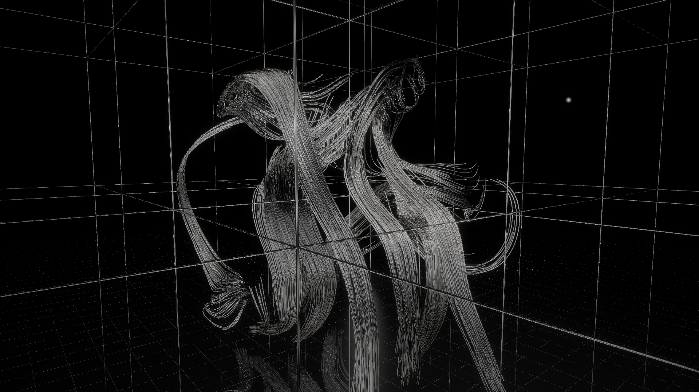
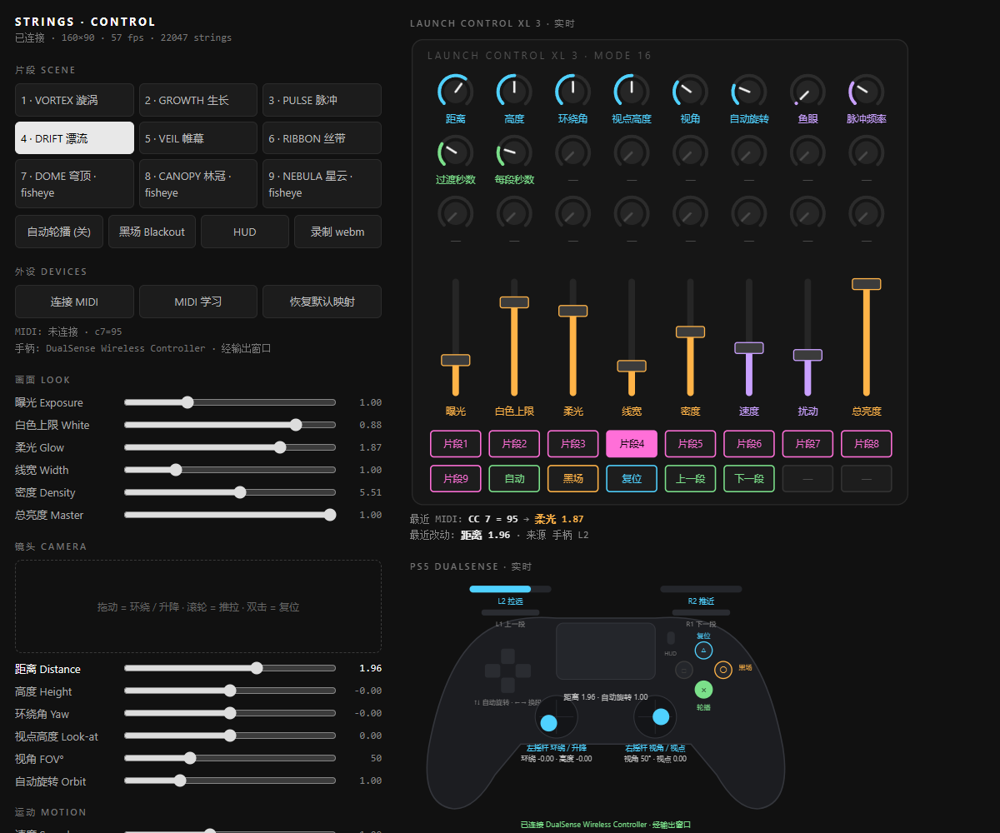

# STRINGS SPACE · v1.0.0

独立空间版本：在 STRINGS 基础上增加空间结构、灯光、金属材质、地面反射与生长镜头追踪。默认服务端口是 **8788**。开发分支为 `strings-space`，本次版本标签为 `strings-space-v1.0.0`；主分支 `main` 继续提供原有 STRINGS 版本。

## 材质与镜头更新

- **材质面板**：金属度、粗糙度、拉丝方向、高光、环境反射、反射方向、灯带宽度、冷暖和自发光。线宽与柔光仍可在画面面板调节。
- **预设**：抛光铬（默认）、拉丝钢、暗钛、原版对照。支持保存和载入一份自定义材质，存储于当前浏览器的 localStorage。
- **生长追踪**：点击“生长追踪”或在画面窗口按 **T**。跟随真实活跃线头的加权中心，配有跟随强度与追踪缓动。默认关闭；复位镜头会关闭追踪。手动环绕、推拉仍可使用。
- **0.2 秒平滑**：数值参数、材质预设、黑场、镜头复位采用帧率无关的指数过渡，约 0.2 秒完成 95% 的变化。场景过渡默认 0.2 秒，可在时间面板修改。HUD 与按钮状态使用 0.2 秒 CSS 渐变；录制等操作命令即时执行。
- **真实 FPS**：显示按实际帧间隔计算；动画模拟仍限制过大的时间步长，但不再用该限制值估算帧率。

金属的主要改动是 GGX 高光、可调粗糙度、沿线方向的各向异性、菲涅耳反射，以及可旋转的程序化摄影棚灯带环境。默认降低自发光和柔光，保留金属的暗部与窄高光；线段切线也做了连续化处理。这里的环境反射是轻量近似，不是场景互相反射或光线追踪。材质模型参考 [Filament 材质说明](https://google.github.io/filament/Filament.md.html)。

追踪每秒约 10 次在 GPU 上取样最多 192 个活跃线头，聚合成一个 RGBA32F 像素。实时模式通过 PBO 与 fence 异步取回 **16 字节**，不会逐帧下载整张模拟纹理；无活跃线头时平滑回到手动镜头。追踪缓动控制主体移动的跟随速度，与操作参数的 0.2 秒响应分开。离线导出用固定步长、同步读取这一个像素，以便输出确定的帧序列。

直接打开 `http://localhost:8788/?scene=2&auto=0&follow=1&material=chrome` 可预览生长追踪。其他材质名为 `brushed`、`titanium`、`original`；离线导出 Query 也可使用 `follow=1&material=chrome`。

## 为什么原版运行流畅

1. **GPU 模拟**：线头与历史轨迹存入两张浮点纹理交替更新，没有逐线、逐点的 JavaScript 更新循环。
2. **批量画线**：线段用实例化薄片模拟圆柱明暗，不逐条创建高边数管道网格。默认 12,000 条线仍涉及大量片段计算，并非零成本。
3. **静态结构缓存**：地面网格、拱线与直线束只在初始化时生成。
4. **反射近似**：地面镜像重画一遍几何，并叠加平面光照，没有递归反射、阴影图或全局光照。
5. **低分辨率柔光**：模糊在半、四分之一、八分之一尺寸的纹理上执行。

新材质比原版增加片元着色开销。窗口尺寸、密度、显卡、反射和抗锯齿都会影响实际帧率，不能从离屏单帧耗时推断浏览器稳定帧率。实时输出仍随窗口尺寸变化；离线文件仍默认为 3840×2160。

## 验证

运行 `node --test tests/material-tracking.test.js` 可检查材质参数、0.2 秒平滑、追踪退回逻辑、异步读取与脚本语法。另在 RTX 4080 Laptop 上用独立 OpenGL 离屏环境编译了全部七组着色器，运行实际 GPU 生长模拟并渲染新旧材质；该检查不是浏览器或 TouchDesigner 的实机帧率测试。

本版本提供浏览器输出；TouchDesigner 接入口见 `main` 分支，本分支暂未集成。

**实时线条视觉、独立控制面板与现场输入控制。**

A browser-based generative line visual system with nine scenes, a separate control panel, MIDI mapping, and gamepad camera control.

STRINGS 在浏览器中模拟流动、生长与聚散的线条，用于投影内容探索、视觉排练和视频输出。画面窗口负责渲染，控制面板负责切换场景、调节参数与读取控制器。



*1920×1080 离屏预览；使用实际视觉着色器在独立 OpenGL 环境中渲染。*

## 功能

- **九个场景**：漩涡、生长、脉冲、漂流、帷幕、丝带，以及三个鱼眼视角场景。
- **实时调节**：曝光、白色上限、柔光、线宽、速度、扰动、脉冲和总亮度。
- **线条密度 0–10**：1 对应 4,000 条线，10 对应 40,000 条线；默认密度为 3。
- **独立控制面板**：场景切换、自动轮播、黑场、镜头控制与实时设备示意图。
- **MIDI 输入**：预置 Launch Control XL 3 Mode 16 映射，支持 MIDI 学习及本地保存。
- **手柄控制**：通过标准 Gamepad 映射读取 DualSense 等设备，控制镜头及播放状态。
- **两种录制方式**：浏览器 WebM 实时录制，或通过 FFmpeg 逐帧导出 MP4。



*截图为开发过程中的界面与视觉示例；其中的分辨率和帧率读数不作为性能指标。*

## 快速开始

### 环境

- Node.js，`node` 命令可在终端运行。本项目服务端使用 Node 内置模块，无需 `npm install`。
- Chrome 或 Edge，启用硬件加速，支持 WebGL2 和 `EXT_color_buffer_float`。
- 导出 MP4 时还需要 FFmpeg，并将 `ffmpeg` 加入 PATH。
- 仓库内的启动与导出脚本面向 Windows；其他平台可手动运行 Node 服务。

```sh
git clone --branch strings-space --single-branch https://github.com/kuanfuweimu/strings-web.git strings-space
cd strings-space
node server.js
```

打开以下两个页面，保持它们使用同一个浏览器配置和同一个地址来源：

| 页面 | 地址 |
| --- | --- |
| 画面输出 | <http://localhost:8788/> |
| 控制面板 | <http://localhost:8788/control.html> |

Windows 下也可直接双击 **`start.bat`**。脚本会启动本地服务，并用独立浏览器配置打开两个窗口。浏览器配置保存在本地 `browser-profile/`。

使用本地服务访问页面，不要直接双击 HTML 文件。输出与控制面板通过同源 `BroadcastChannel` 通信；`localhost` 和 `127.0.0.1` 不应混用。

## 场景

| 编号 | 场景 | 视觉方向 |
| --- | --- | --- |
| 1 | Vortex · 漩涡 | 环绕聚集的线束 |
| 2 | Growth · 生长 | 缓慢向上延伸的线条 |
| 3 | Pulse · 脉冲 | 随脉冲聚散、扩张 |
| 4 | Drift · 漂流 | 松散漂移的流线 |
| 5 | Veil · 帷幕 | 垂落、流动的线幕 |
| 6 | Ribbon · 丝带 | 连续弯曲的线束 |
| 7 | Dome · 穹顶 | 鱼眼视角下的环绕流动 |
| 8 | Canopy · 林冠 | 鱼眼视角下的向上生长 |
| 9 | Nebula · 星云 | 鱼眼视角下的漂移结构 |

## 操作

将输出窗口移到目标显示器，再按 **F** 或双击画面进入全屏。控制面板可以留在另一块屏幕上。

| 输入 | 功能 |
| --- | --- |
| `1`–`9` | 切换场景并关闭自动轮播 |
| `←` / `→` | 上一段 / 下一段 |
| 空格 | 开关自动轮播 |
| `F` / 双击画面 | 进入或退出全屏 |
| `H` | 显示或隐藏画面信息，默认隐藏 |
| `T` | 开关生长镜头追踪 |
| `C` | 打开控制面板 |
| `R` | 开始或停止 WebM 录制 |
| 控制面板镜头区域拖动 / 滚轮 / 双击 | 环绕与升降 / 推拉 / 镜头复位 |

实时画面的分辨率随输出窗口和设备像素比变化。全屏不等于固定 4K；固定分辨率的文件请使用下面的离线导出。

### Launch Control XL 3 / MIDI

1. 接入设备，在控制面板点击 **连接 MIDI**，按浏览器提示授权。
2. 默认映射对应代码中的 **Mode 16** 配置。
3. 如设备模板或 CC 编号不同，开启 **MIDI 学习**，点击参数名称，再移动对应旋钮或推子；场景按钮、自动轮播和黑场也可学习绑定。
4. 映射保存在当前浏览器的 `localStorage`；更换浏览器配置后需重新设置。

| MIDI CC | 默认功能 |
| --- | --- |
| 5–12 | 曝光、白色上限、柔光、线宽、密度、速度、扰动、总亮度 |
| 13–20 | 镜头距离、高度、环绕角、视点高度、视角、自动旋转、鱼眼、脉冲 |
| 21–22 | 过渡时长、每段时长 |
| 37–45 | 场景 1–9 |
| 46–50 | 自动轮播、黑场、镜头复位、上一段、下一段 |

[查看 Launch Control XL 3 映射图](docs/lcxl3_map.png)

### PS5 DualSense / 标准映射手柄

接入 USB 或蓝牙后，在页面中按一下手柄按键，并保持控制面板打开。

| 输入 | 功能 |
| --- | --- |
| 左摇杆 | 环绕与镜头升降 |
| 右摇杆 | 视角与视点高度 |
| L2 / R2 | 拉远 / 推近 |
| L1 / R1，方向键左 / 右 | 上一段 / 下一段 |
| 方向键上 / 下 | 调节自动旋转 |
| △ | 镜头复位 |
| ○ | 黑场 |
| × | 自动轮播 |
| Options | 显示或隐藏画面信息 |

[查看 DualSense 映射图](docs/dualsense_map.png)

映射按浏览器的标准 Gamepad 布局读取；实际识别情况取决于设备、连接方式及浏览器。项目已进行模拟输入测试，使用前仍需核对实际硬件。

## 视频导出

### 实时 WebM

在输出窗口按 **R**，或点击控制面板的录制按钮；再次操作结束并下载 WebM。实时录制受浏览器和 GPU 实际运行速度影响。

### 逐帧 MP4

Windows 的 `export.ps1` 使用 Chrome、固定时间步进与 FFmpeg 编码。默认导出全部九个场景，每段 **3840×2160、60 fps、10 秒**。

先结束已占用 8788 端口的本项目 Node 服务，再在项目目录运行：

```powershell
powershell -NoProfile -ExecutionPolicy Bypass -File .\export.ps1
```

指定场景、时长与密度，例如只导出生长场景，密度 6、时长 20 秒：

```powershell
powershell -NoProfile -ExecutionPolicy Bypass -File .\export.ps1 -Query 'w=3840&h=2160&fps=60&secs=20&scenes=2&density=6'
```

`scenes` 使用 1–9 编号，也可传入逗号分隔的列表；`all` 表示全部。输出写入 `out/`，重复导出相同场景会覆盖同名 MP4，需要保留时请先另存。

默认使用 NVIDIA NVENC。没有可用的 NVIDIA 编码器时，在当前 PowerShell 中改用软件编码：

```powershell
$env:ENCODER = 'x264'
.\export.ps1
```

离线输出为 60 fps 不代表浏览器实时运行能达到 60 fps。实时性能受分辨率、线条密度、GPU 和其他运行程序影响。

## 工程结构

```text
strings-space/
├── index.html       # WebGL2 模拟、渲染、场景与视频帧输出
├── control.html     # 独立控制面板、MIDI 与手柄映射
├── server.js        # 本地 HTTP 服务和 FFmpeg 编码入口
├── materials.js     # 材质参数、预设与校验
├── growth-tracker.js # GPU 线头取样与平滑跟随
├── parameter-lag.js  # 0.2 秒参数过渡
├── start.bat        # Windows 启动入口
├── start.ps1        # 启动服务及双窗口
├── export.ps1       # 离线 MP4 导出入口
└── docs/            # 控制器说明、映射图与项目预览
```

`out/` 导出视频、`shots/` 开发测试素材、`browser-profile/` 浏览器个人数据均不纳入 Git。本仓库仅包含网页工程。

## 使用说明

- **控制面板显示“等待输出窗口”**：确认输出页面已打开，两页的主机名、端口及浏览器配置一致。
- **MIDI 已授权但无设备**：检查连接，关闭可能占用设备的其他软件，再点击连接 MIDI。
- **手柄没有被识别**：先按一个按键，并确认浏览器报告标准 Gamepad 映射。
- **画面性能不足**：先降低密度、输出窗口分辨率，或减少同时运行的输出窗口。
- **多块屏幕需要完全相同的画面**：每个输出窗口各自运行模拟，参数同步不会让画面逐帧一致。需要一致画面时，可复制同一路显示输出。

视觉研究参考：[MONOCOLOR — Entangled Structures](https://mnclr.com/entangled-structures)。本仓库提供浏览器视觉系统的实现与控制工具。
